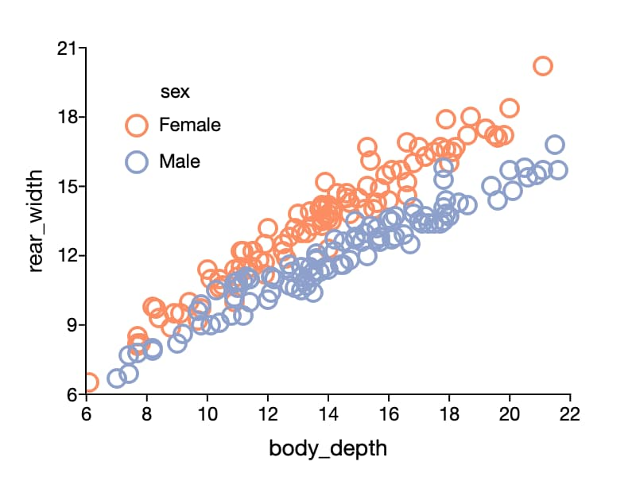
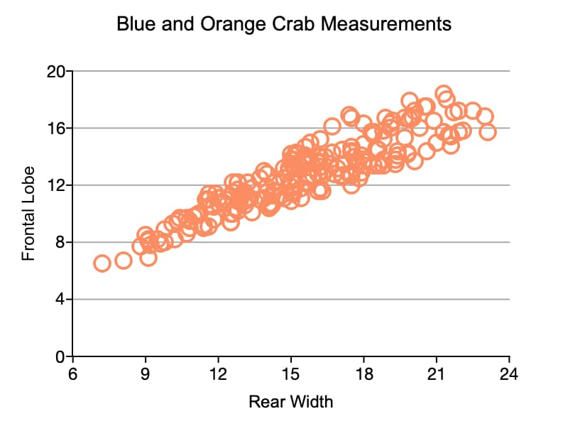

plotScatter
==============================================

Purpose
----------------
Creates a 2-dimensional scatter plot.

Format
----------------
.. function:: plotScatter([myPlot, ]x, y [, title={}, xlabel={}, ylabel={}, xlim={}, ylim={}, colors={}, legend={}, legend_location={}, line_width={}, marker={}, grid={}])
              plotScatter([myPlot, ]df, formula [, title={}, xlabel={}, ylabel={}, xlim={}, ylim={}, colors={}, legend={}, legend_location={}, line_width={}, marker={}, grid={}])

    :param myPlot: Optional argument, a :class:`plotControl` structure.
    :type myPlot: struct

    :param x: Each column contains the X values for a particular data point.
    :type x: Nx1 or NxM matrix

    :param y: Each column contains the Y values for a particular data point.
    :type y: Nx1 or NxM matrix

    :param df: The data referenced by the formula string.
    :type df: NxM dataframe.

    :param formula: formula string describing which variables to plot.
        E.g ``"mpg ~ weight"``, will plot ``mpg`` along the y-axis and ``weight`` along the x-axis;

        E.g ``"age + education  ~ rating"`` will plot ``age`` and ``education`` along the y-axis against ``rating`` on the x-axis;

        E.g ``"education  ~ rating + by(gender)"`` will split the data by the ``gender`` variable and then plot both groups with ``education`` along the y-axis against ``rating`` on the x-axis;

    :type formula: string

Plot keywords
++++++++++++++++++++++++

Named settings override the corresponding settings on a copy of ``myPlot``.
Omit a keyword or use ``{}`` to use the control or plot defaults.
Named labels take precedence over labels generated from the data.

.. list-table::
    :header-rows: 1
    :widths: 25 75

    * - Keyword
      - Meaning
    * - ``title``
      - Plot title. Use ``""`` to clear it.
    * - ``xlabel``
      - X-axis label. Use ``""`` to clear it.
    * - ``ylabel``
      - Y-axis label. Use ``""`` to clear it.
    * - ``xlim``
      - Two numbers, ``min | max`` or ``min ~ max``, for a numeric X axis.
    * - ``ylim``
      - Two numbers, ``min | max`` or ``min ~ max``, for a numeric Y axis.
    * - ``colors``
      - Color names or RGB values as accepted by :func:`plotSetLineColor`.
    * - ``legend``
      - One string label per series. Use ``""`` to clear the legend.
    * - ``legend_location``
      - Up to three words from ``top``, ``vcenter`` (or ``middle``), ``bottom``, ``left``, ``hcenter``, ``right``, ``inside`` and ``outside``. ``center`` fills an unspecified direction, or both when used alone.
    * - ``line_width``
      - A nonnegative numeric width, or a vector of widths.
    * - ``line_style``
      - Unavailable on ``plotScatter``.
    * - ``marker``
      - Symbol numbers −1 through 14 and names from :func:`plotSetLineSymbol`, with shortcuts ``o``, ``s``, ``d``, ``^``, ``v``, ``+``, ``x``, ``*`` and ``h``.
    * - ``grid``
      - ``0`` (off), ``1`` (major grid), ``"major"``, ``"minor"`` or ``"both"``.

Keywords in a plot call
++++++++++++++++++++++++

::

    scores = { 49, 63, 68, 81, 85 };
    plotScatter(1:5, scores, title="Practice and scores", xlabel="Practice sessions",
        ylabel="Score", colors="steelblue", marker="d", grid="major");

Examples
----------------

Example 1: Formula string with the 'by' keyword
+++++++++++++++++++++++++++++++++++++++++++++++++

We can create the above image with the code below.

::

    // Create file name with full path
    fname = getGAUSSHome("examples/crabs.dta");

    // Load all variables from the dataset
    crabs = loadd(fname);
    
    // Draw the scatter plot using your preference settings
    plotScatter(crabs, "rear_width ~ body_depth + by(sex)");

Note that when using a formula string, the axis labels and legend are filled in automatically.

Example 2: Customized plot without formula string
++++++++++++++++++++++++++++++++++++++++++++++++++++

::

    // Create file name with full path
    fname = getGAUSSHome("examples/crabs.dta");

    // Load all variables from the dataset
    crabs = loadd(fname);

    // Declare plt to be a plotControl structure
    // and fill with default settings for scatter
    struct plotControl plt;
    plt = plotGetDefaults("scatter");
    
    plotSetTitle(&plt, "Blue and Orange Crab Measurements", "arial", 14);
    
    // Axis labels
    plotSetYLabel(&plt, "Frontal Lobe", "arial", 12);
    plotSetXLabel(&plt, "Rear Width");
    
    // Span the Y range from 0 to 20
    plotSetYRange(&plt, 0, 20);
    
    // Draw Y-ticks every 4 units starting at 0
    plotSetYTicInterval(&plt, 4, 0);
    
    // Create grid lines coming from the major ticks
    // on the Y axis and color them dark gray
    plotSetYGrid(&plt, "major", "dark gray");
    
    // Draw plot
    plotScatter(plt, crabs[.,"rear_width"], crabs[.,"frontal_lobe"]);

.. seealso:: Functions :func:`plotXY`, :func:`plotLogLog`, :func:`plotBox`, :func:`plotHistP`
